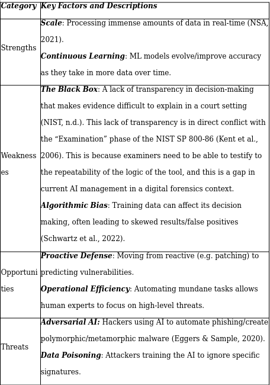

# Secure Integration of AI in Cybersecurity: A NIST AI RMF 1.0 Analysis

A written security analysis of the dual-use nature of AI/ML in Digital Forensics and Incident Response (DFIR): where it strengthens defensive operations, the non-traditional attack surface it introduces, and how the NIST AI Risk Management Framework (AI RMF 1.0) can govern its deployment. This directory is the analysis itself — a research/position piece, not a hands-on lab.

> **Scope.** This is a graduate coursework *written analysis*, not a practical exercise. There is no tooling, dataset, or exploit here — no model was trained, attacked, or defended. Claims below are literature- and framework-based reasoning about AI risk in DFIR, mapped to published standards, not results measured in a lab. The accompanying SWOT table is the analytical artifact; the prose is its summary.

## Artifacts in this directory

| Path | Contents |
|---|---|
| [`Images/SWOT_Analysis_Table.png`](./Images/SWOT_Analysis_Table.png) | SWOT table assessing the trade-offs of AI integration in an enterprise security posture |

## Applied frameworks and standards

| Framework | Role in the analysis |
|---|---|
| NIST AI RMF 1.0 | Core functions — **Govern, Map, Measure, Manage** — used as the governance spine for trustworthy AI deployment |
| NIST SP 800-86 | Aligning AI-assisted forensics with established incident-response guidance |
| NIST SP 1270 | Framing for adversarial / red-team testing of models |
| ISO/IEC 27037:2012 | Preserving integrity, reliability, and admissibility of AI-assisted digital evidence |

---

## Analysis

### 1. Defensive applications in DFIR

- **Malware analysis.** Heuristic sandboxing, risk-scoring automation, and static analysis of obfuscated code — including NLP applied to disassembled instructions — to counter polymorphic threats that evade signature matching.
- **Network forensics.** Behavioral baselining, log correlation at scale, and lateral-movement detection to compress threat-actor dwell time.

### 2. Threat modeling — the AI attack surface

An evaluation of vulnerabilities specific to ML systems, which traditional security controls do not address:

- **Adversarial evasion.** Perturbing inputs along model gradients to bypass a classifier while appearing benign.
- **Data poisoning.** Injecting malicious samples into training data to create deliberate, systematic blind spots.
- **Model inversion & membership inference.** Reconstructing training data or internal model logic to gain architectural or privacy-defeating advantage.
- **Dependency risk.** Supply-chain exposure in open-source ML libraries (TensorFlow, PyTorch) and their transitive dependencies.

### 3. SWOT analysis

A structured Strengths / Weaknesses / Opportunities / Threats assessment of AI integration into enterprise security, centered on the accountability problem of "black box" decision-making in legal and forensic settings — where an unexplainable model output is a liability, not just a technical gap.

## Strategic recommendations

- **Shadow-AI prevention.** Maintain a centralized model registry documenting each active model's source, training data, and human owner — no unregistered models in production.
- **Supply-chain auditing.** Subject vendor-provided security models to third-party audit rather than trusting them by default.
- **Adversarial testing.** Run regular red-team operations (per NIST SP 1270) to surface model drift and exploitable gradients before an attacker does.
- **Failsafe architecture.** Enforce human-in-the-loop review and emergency override ("kill switch") controls so an automated failure cannot cascade unchecked.

## Limitations

- Written analysis only — no model was built, attacked, or evaluated; there are no empirical results in this directory.
- Framework mappings (NIST AI RMF, SP 800-86, SP 1270, ISO/IEC 27037) are applied conceptually, not through a measured assessment of a specific system.
- The SWOT table reflects general enterprise reasoning, not a named organization's posture.
